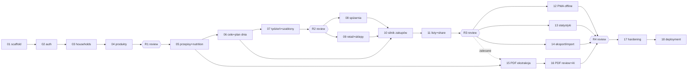

# 00 — Master Plan implementacji Family Food Planner

Data: 2026-08-16 · Faza planistyczna (bez implementacji) · Właściciel: Michał
Metodyka: adaptacja sprawdzonego procesu netQArnera (jeden batch = jedna
świeża sesja agenta; living documentation; rejestr decyzji; review batche).

## 1. Executive overview

FFP = prywatna aplikacja rodzinna: produkty kanoniczne → przepisy →
planowanie dni/tygodni → kalorie/makro/ŁG → spiżarnia → silnik zakupowy →
listy (mobile/print/QR/link publiczny) → PWA/offline → import PDF diet →
produkcja na Odroid H2 (Docker Compose, za istniejącym reverse proxy).

Stack (twardy): FastAPI + SQLAlchemy + Alembic + Pydantic + PostgreSQL;
Vue 3 + TS + Vite + Tailwind + Pinia + shadcn-vue; Playwright + pytest.
Architektura: modularny monolit (ADR-001). UI wyłącznie PL (D3).

Kluczowa konsekwencja decyzji D2 (czysty start danych): aplikacja rusza
z pustą bazą — treść wchodzi ręcznie (inline create) oraz przez **PDF
importer**, który jest pełnoprawnym filarem planu (B15–B16), z wiążącym
kontraktem w `01_PDF_AUDIT.md`.

## 2. Dokumenty programu

| Plik | Rola |
|---|---|
| `docs/architecture/01…09_*.md` | architektura: przegląd, domena, DB, API, frontend, UX, security, testy, deployment/backup |
| `docs/adr/ADR-001…014` | trwałe decyzje techniczne (nie podejmować ponownie!) |
| `docs/implementation-plan/01_PDF_AUDIT.md` | zmierzony kontrakt importera PDF |
| `docs/implementation-plan/02_DECISIONS.md` | rejestr decyzji właściciela (D-numery, bramki batchy) |
| `docs/implementation-plan/03_AI_SKILLS.md` | skille/narzędzia AI używane przy implementacji |
| `docs/implementation-plan/PROGRESS.md` | status batchy + dziennik „o czym muszą wiedzieć następne batche" |
| `docs/implementation-plan/implementation_prompt.md` | master prompt uruchamiania batchy |
| `docs/implementation-plan/batches/BATCH_*.md` | karty batchy (komplet do wykonania w 1 sesji) |

## 3. Lista batchy

Klasy: FOUND=fundamenty, CORE=rdzeń, SHOP=zakupy, PLAT=platforma,
PROD=produkcja, REV=review. Batch identyfikowany NAZWĄ (nie „X z N" —
plan może się zmieniać).

| Batch | Nazwa | Klasa | Zależy od | Bramki decyzji |
|---|---|---|---|---|
| 01 | PROJECT_SCAFFOLD_AND_DEV_LOOP | FOUND | — | — |
| 02 | AUTH_AND_ACCOUNTS | FOUND | 01 | — |
| 03 | HOUSEHOLDS_AND_SCOPE | FOUND | 02 | — |
| 04 | UNITS_AND_CANONICAL_PRODUCTS | FOUND | 03 | — |
| R1 | REVIEW_FOUNDATIONS | REV | 01–04 | — |
| 05 | RECIPES_AND_NUTRITION_ENGINE | CORE | 04, R1 | — |
| 06 | GOALS_AND_DAY_PLAN | CORE | 05 | — |
| 07 | WEEK_TEMPLATES_AND_CYCLES | CORE | 06 | — |
| R2 | REVIEW_PLANNING_CORE | REV | 05–07 | — |
| 08 | PANTRY | SHOP | 04, R2 | — |
| 09 | RETAIL_PRODUCTS_AND_STORES | SHOP | 04, R2 (równolegle z 08 — patrz §5) | — |
| 10 | SHOPPING_ENGINE | SHOP | 06, 08, 09 | — |
| 11 | SHOPPING_LISTS_AND_SHARING | SHOP | 10 | — |
| R3 | REVIEW_SHOPPING | REV | 08–11 | — |
| 12 | PWA_AND_OFFLINE | PLAT | 11, R3 | — |
| 13 | STATISTICS | PLAT | 06, R3 (równolegle z 12) | — |
| 14 | IMPORT_EXPORT | PLAT | R3 (wszystkie encje core) | — |
| 15 | PDF_IMPORT_EXTRACTION | PLAT | 05 (zalecane po R3) | — |
| 16 | PDF_IMPORT_REVIEW_AND_AI | PLAT | 15, 04 | D5 (zatwierdzona) |
| R4 | REVIEW_PRE_PRODUCTION | REV | wszystkie 01–16 | — |
| 17 | PRODUCTION_HARDENING | PROD | R4 | — |
| 18 | PRODUCTION_DEPLOYMENT_AND_OPERATIONS | PROD | 17 | **D6, D7** |

## 4. Graf zależności



## 5. Kolejność wykonania i równoległość

Sekwencja bazowa = numeracja. Dozwolone równolegle (osobne git worktree,
brak wspólnych plików — sprawdzić przed startem!): **B08 ∥ B09**,
**B12 ∥ B13 ∥ B14**. Wszystkie inne batche idą sekwencyjnie — dotykają
wspólnych plików (routery, nawigacja, schema). Lekcja netQArnera: nigdy
dwa batche naraz w tym samym katalogu roboczym; po merge'u gałęzi
z migracją `alembic heads` musi zwracać jedną głowę.

Minimalny zestaw „aplikacja używalna na co dzień": B01–B11 (plan + zakupy).
B15–B16 dowożą treść (przepisy z diet) — bez nich baza jest pusta poza
wpisami ręcznymi, dlatego NIE odkładać ich za B17/B18.

## 6. Szablon karty batcha (obowiązkowy)

Każdy plik `batches/BATCH_XX_NAZWA.md` ma dokładnie te sekcje:

```markdown
# BATCH_XX — NAZWA
Klasa · Zależności (batche + decyzje-bramki) · Szacunek rozmiaru (S/M/L)
## Goal            — 2–4 zdania: co użytkownik/system umie po batchu
## Context         — co już istnieje i gdzie (pliki), co ten batch zastaje;
                     wymagane lektury (sekcje architektury/ADR/decyzji)
## Stages          — ponumerowane etapy wykonania w kolejności (DB → backend
                     → frontend → testy → docs); każdy etap = weryfikowalny stan
## Database / migrations — tabele/kolumny/indeksy (zgodnie z 03_DATABASE),
                     zasady migracji (numer = pierwszy wolny; down testowany)
## Backend         — endpointy (tabela: ścieżka, metoda, rola), serwisy, walidacje
## Frontend        — strony/komponenty/stores, wzorce z 05/06 (create-in-context!)
## Security        — czego batch dotyka (auth/scope/upload/tokeny) i jak chroni
## Skills          — Required / Recommended / Review: identyfikatory SKILL-*
                     z 03_AI_SKILLS §3 (Required ładowane na starcie sesji,
                     Review uruchamiane na diffie przed commitem)
## Tests           — konkretne przypadki per poziom (unit/int/api/fe/e2e);
                     obszary krytyczne z 08_TESTING §2, macierz uprawnień §4
## Acceptance Criteria — ponumerowane, sprawdzalne ręcznie lub testem
## Out of Scope    — czego świadomie NIE robimy (z odesłaniem gdzie trafi)
## Expected files/modules — lista plików nowych/zmienianych
## Implementation Notes — pułapki, kolejność, decyzje pozostawione
                     implementującemu (z obowiązkiem uzasadnienia)
## Cross-Batch Impact — na które przyszłe batche wpływa; co zaktualizować
## Implementation checklist — [ ] odhaczane w trakcie
## Verification checklist — [ ] testy, lint, typecheck, migracje up/down,
                     dokumentacja, acceptance criteria
## Completion notes — (wypełnia agent: wykonane / odstępstwa / decyzje /
                     follow-upy / pytania do właściciela)
```

## 7. Definition of Done batcha

Batch jest DONE wyłącznie, gdy: implementacja ukończona; migracje
wykonane i odwracalne; `task check` zielony (testy+lint+typecheck);
acceptance criteria spełnione; odstępstwa zapisane w Completion notes;
pytania właściciela rozstrzygnięte albo jawnie zaparkowane w 02_DECISIONS;
ADR dopisany, jeśli powstała trwała decyzja; **Cross-Batch Impact
przeniesiony do plików przyszłych batchy** (nie tylko wspomniany!);
dokumentacja architektury zaktualizowana do stanu faktycznego;
PROGRESS.md zaktualizowany (status + wpis dziennika); **commit wykonany**:
`batch(XX): <opis>` — jeden finalny commit na batch, `git status` czysty
w zakresie plików batcha. Bez commita batch NIE jest done (lekcja
netQArner B07). Push wykonuje właściciel po review.

## 8. Living documentation i propagacja decyzji

Po każdym batchu agent sprawdza, czy implementacja spowodowała:
odstępstwa od architektury, nowe constraints, zmianę kontraktów/modelu,
nowe zależności, dług techniczny, zmianę założeń przyszłych batchy.
Jeśli tak: aktualizuje dokument architektury (stan FAKTYCZNY), dopisuje
ADR (decyzja trwała) lub wpis w 02_DECISIONS (decyzja właściciela),
**edytuje pliki dotkniętych przyszłych batchy** (sekcja Context/Implementation
Notes) i odnotowuje wszystko w PROGRESS.md. Następna czysta sesja nie
może być zmuszona do archeologii.

## 9. Review batche (R1–R4)

Review nie dodaje feature'ów. Sprawdza: implementacja vs architektura,
DB vs model domenowy, kontrakty API, granice modułów, stan frontendu
(struktura stores/query), security (w tym `/security-review`), pokrycie
testami obszarów krytycznych, dług/TODO/workaroundy, kompletność
propagacji decyzji. Analizuje przyszłe batche i wolno mu: zmienić
kolejność/zakres, podzielić/scalić/dodać batch — z udokumentowanym
powodem w PROGRESS + aktualizacją tego planu. Werdykt do PROGRESS.md.
Umiejscowienie R1–R4 = naturalne milestone'y (fundamenty / rdzeń
planowania / zakupy / przed produkcją).

## 10. Ryzyka programu

| Ryzyko | Mitygacja |
|---|---|
| Pusta baza po starcie (D2) zniechęca do używania | inline create wszędzie (B04+), importer PDF nie później niż po R3, seed demo do testów (nie do produkcji) |
| Rozjazd wyliczeń kcal vs oczekiwania z PDF | silnik czysty + snapshoty PDF jako metadane walidacyjne + issue przy >10% |
| Zaklikana obsługa (antyteza celu) | 06_UIUX §2 jako kryterium review każdego batcha UI |
| Model porcji rodzinnych komplikuje prosty przypadek | prosty mnożnik domyślny; rozkład rodzinny opcjonalny (02_DOMAIN §7) |
| Offline sync psuje stan checkboxów | ADR-009: LWW per pozycja + testy scenariuszy offline |
| Sekrety w repo | .env w .gitignore od B01; create-admin przez CLI; review sprawdza |
| Batch przekracza jedną sesję | rozmiar S/M/L w karcie; L tylko B10, B16, B18 — jeśli pęka, review dzieli |

## 11. Traceability wymagań właściciela → batche

| Wymaganie (prompt zlecenia) | Batch |
|---|---|
| Role ADMIN/USER, konta | 02 |
| Household, scope PRIVATE/HOUSEHOLD | 03 |
| Produkty kanoniczne, wartości, weryfikacja, jednostki, kategorie | 04 |
| Usuwanie: blokada + archiwum | 04 (wzorzec), potem wszędzie |
| Inline creation | 04 (wzorzec ProductPicker), egzekwowane w 05–11 |
| Dania/przepisy, tagi, oceny, porcja bazowa | 05 |
| Kalorie/makro/IG→ŁG, cele dzienne i per posiłek | 05 (silnik), 06 (cele+dzień) |
| Plan dnia (dowolne posiłki), mnożniki, dopasuj do celu | 06 |
| Skalowanie rodziny (7 porcji / 3×1.0+2×0.8+2×1.3), profile | 06 (model), 07 (UI tygodnia) |
| Model tygodnia 2+2+2+warzywny, kopiuj dzień/posiłek/blok | 07 |
| Szablony dnia/tygodnia, cykle A→B→C, historia „użyj ponownie" | 07 |
| Spiżarnia + jawne pytanie + „mam już w domu" | 08 (stan), 10 (pytanie/overrides) |
| Retail products, sklepy, profile kolejności kategorii | 09 |
| Pipeline zakupowy, tury (preset nd/śr), opakowania, resztki, preview | 10 |
| Lista zakupowa: mobile, druk, QR, share, token publiczny, expiry | 11 |
| PWA + offline lista | 12 |
| Statystyki | 13 |
| Import/eksport (JSON/ZIP, własność danych) | 14 |
| PDF importer (pipeline, review, AI-asysta) | 15, 16 |
| Audit log | 03 (fundament), 04/14/16 (zapisy) |
| Produkcja: secrets/health/backup/restore/update/rollback | 17, 18 |

## 12. Zmiany planu

Plan jest żywy. Zmiany wprowadzają: Review batche (R1–R4), decyzje
właściciela (02_DECISIONS) i istotne odkrycia w batchach (przez
Cross-Batch Impact). Każda zmiana: powód w PROGRESS.md + aktualizacja
tego dokumentu i dotkniętych kart batchy w tym samym commicie.
